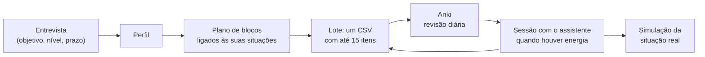

# Idiomas com IA

**Um método eficiente, flexível e configurável para aprender qualquer língua com um assistente de IA e o Anki.**

Você conta para o assistente *para que* precisa da língua — uma viagem, uma reunião, uma mudança,
uma prova. Ele monta o plano em cima das situações que você vai viver, gera o material e transforma
tudo em cartões para o Anki. Você revisa alguns minutos por dia no celular e, quando tem energia,
estuda com o assistente.

Funciona no **ChatGPT, no Claude ou no Gemini**, até só pelo celular. Para quem usa Claude Code, há
uma rota avançada com comandos, páginas de estudo, diário e validador.

---

## O problema que isto resolve

"Quero aprender uma língua com IA" costuma dar em uma de duas coisas: conversas soltas com o
chatbot, que parecem produtivas e não deixam nada na memória, ou um aplicativo que ensina a mesma
coisa para todo mundo, na mesma ordem. Falta **método**: o que aprender primeiro, como transformar o
que a IA gera em memória de longo prazo, e como saber se está funcionando.

Este repositório é esse método, pronto para usar e ajustar.

## Como funciona



1. **A entrevista configura tudo.** Língua e variante, para quê, até quando, o que você já sabe, o
   que fica de fora. Sai um `perfil.md` que o assistente lê antes de qualquer coisa.
2. **O plano segue as suas situações**, não um livro-texto. Quem vai a um jantar de negócios em
   Tóquio precisa de outras 300 palavras do que quem vai fazer intercâmbio em Madri.
3. **Tudo vira cartão.** Palavras, frases, turnos de diálogo, padrões de gramática, exercícios. O que
   fica só na conversa não é revisado — e não é aprendido.
4. **O cartão que importa é o de produção.** A frente não é "obrigado" — é *"o garçom traz o seu
   prato"*. Você treina reagir à situação, não traduzir.
5. **Revisão é diária e pequena; conteúdo novo entra quando há energia.** São duas trilhas
   separadas, porque a fila de revisão cresce sozinha e o material novo pode esperar.

## Começar

### Rota 1 — chat (ChatGPT, Claude ou Gemini), até pelo celular

1. Instale o Anki: [AnkiMobile](https://apps.apple.com/app/ankimobile-flashcards/id373493387)
   (iPhone), [AnkiDroid](https://play.google.com/store/apps/details?id=com.ichi2.anki) (Android) ou
   [Anki](https://apps.ankiweb.net) (computador).
2. Importe o pacote da sua língua, em [`anki/pacotes/`](anki/pacotes/).
3. Crie um **Projeto** (ChatGPT ou Claude) ou um **Gem** (Gemini). Cole
   [`assistente/instrucoes.md`](assistente/instrucoes.md) nas instruções e envie
   [`assistente/metodo.md`](assistente/metodo.md) e [`assistente/perfil.md`](assistente/perfil.md)
   como arquivos.
4. Diga **"começar"**. Responda a entrevista e substitua o `perfil.md` do projeto pelo preenchido.
5. Peça **"monta meu plano"**, importe o primeiro lote e siga.

Passo a passo, com as diferenças entre as plataformas: [`docs/como-usar.md`](docs/como-usar.md).

### Rota 2 — Claude Code, no computador

```bash
git clone https://github.com/AndreDenofrioAPI4COM/idiomas-com-ia.git meu-espanhol
cd meu-espanhol
claude
> /comecar
```

Os comandos (`/curriculo`, `/vocab`, `/gramatica`, `/tema`, `/leitura`, `/historia`, `/musica`,
`/revisao`, `/avaliacao`) gravam páginas de estudo em HTML, lotes em CSV, diário e progresso — e o
`python ferramentas/validar_csv.py` confere cada lote antes da importação.

## O que tem aqui

| Onde | O quê |
|---|---|
| [`assistente/`](assistente/) | o "cérebro": instruções, método operacional e o modelo de perfil. As duas rotas usam |
| [`anki/pacotes/`](anki/pacotes/) | um `.apkg` por língua: cria o tipo de nota, o deck e os cartões de Produção, Escuta e (em escrita não latina) Leitura |
| [`docs/`](docs/) | [como usar](docs/como-usar.md) · [o método](docs/metodo.md) · [de onde veio](docs/inspiracao.md) · [FAQ](docs/faq.md) · [Anki](docs/anki.md) |
| [`ferramentas/`](ferramentas/) | `validar_csv.py` (confere os lotes) e `gerar_pacotes.py` (cria pacote para outra língua) |
| `CLAUDE.md`, [`.claude/`](.claude/) | a rota Claude Code: constituição, 10 comandos e a skill das páginas HTML |
| [`modelos/`](modelos/), [`assets/`](assets/) | modelos das páginas de estudo da rota Claude Code |

Pacotes prontos: inglês, espanhol (Espanha e América), francês, alemão, italiano, japonês,
mandarim, coreano e russo. Outra língua: `python ferramentas/gerar_pacotes.py --lingua Holandes --tts nl_NL --obrigado "dank je"`.

## De onde veio

O método nasceu de um projeto pessoal: aprender mandarim do zero em 12 semanas para uma missão de
negócios à China, usando um assistente de IA no lugar do livro-texto. Ele parte de duas fontes:

- **[The Ultimate LLM Prompt Library for Language Learners](https://www.languagejones.com)**, do
  Dr. Taylor Jones (Language Jones) — sete prompts que transformam um LLM em livro-texto, e os
  vídeos do canal sobre o mesmo assunto.
- **Fluent Forever**, de Gabriel Wyner — sons primeiro, não traduzir, repetição espaçada, um cartão
  por fato.

O que este repositório acrescenta, e onde as fontes discordam: [`docs/inspiracao.md`](docs/inspiracao.md).
Não há afiliação com nenhum dos autores.

## Limites, ditos de frente

- **A IA não ouve você.** Nenhum assistente aqui avalia pronúncia, e o método proíbe que ele finja.
  Ouvido, gravação semanal, ditado por voz e um falante nativo fazem esse papel.
- **A IA erra.** Ela marca `⚠️ verificar` quando não tem certeza, mas um iniciante não detecta erro
  plausível. Mostre o material a um nativo sempre que puder.
- **Método não substitui uso.** Ele leva você até a situação real preparado; a fluência acontece nela.

## Contribuir

Encontrou um erro, testou em outra língua, adaptou para outra plataforma? Abra uma *issue* ou um
*pull request*. Relatos de uso real ("fiz por 8 semanas para X, funcionou isto, falhou aquilo") são
a contribuição mais valiosa.

Licença [MIT](LICENSE).

---

### In English

*Idiomas com IA* is a configurable method for learning any language with an AI assistant
(ChatGPT, Claude, Gemini or Claude Code) and Anki. An onboarding interview builds a learner profile
around the real situations you need the language for; the assistant then generates a plan, material
and Anki-ready CSV batches whose production cards show a *situation* on the front instead of a
translation. Daily review and new material run on separate tracks. Docs are in Brazilian
Portuguese, but the assistant explains in whatever language your profile sets. Inspired by
Dr. Taylor Jones's *Ultimate LLM Prompt Library for Language Learners* and Gabriel Wyner's
*Fluent Forever*.
